# GrayMoon Git Changes — Reliable Watcher Lifecycles and Self-Healing Monitoring

**Status:** Proposed design; code inspected, implementation not started  
**Date:** 2026-10-27  
**Scope:** App ↔ Worker Git Changes monitoring; all Workspace and Feature contexts  
**Baseline:** `Jandini/GrayMoon`, `main`, files inspected on 2026-10-27 (GitHub links below reference inspected commit `3731b5c1e5068da2a552167134efa48c5080bae2`).

## 1. Executive decision

**Maintain the existing 10-minute idle watcher eviction, but decouple watcher renewal from Git status scans and guarantee automatic reconciliation after coverage gaps.** Workspace presence—not mouse movement or keyboard activity—determines whether to keep monitoring. Treat a full scan as a **correctness/audit** operation, not a lease-renewal operation. No UI changes are in scope.

The issue was seen in **two environments**:

- A roughly **20-repository fast machine**, with fast local Git operations.
- A roughly **39-repository enterprise VDI** with relatively expensive Git operations.

Consequently, **slow Git scanning is a plausible amplifier, not a demonstrated root cause**. The first engineering milestone must reproduce and instrument the failure in both modes. The design must cover lifecycle races, route/circuit presence, Worker restarts/reconnects, watcher setup failures, silent delivery losses, and expiry—not just performance.

### Non-negotiable user contract

> Leave GrayMoon showing any page of Workspace A while an AI agent edits its repositories for 30, 60, or 120 minutes. When changes occur, they are reflected automatically. Returning to the app must reconcile anything missed, without the user pressing **Refresh**.

A workspace explicitly left and not viewed by any circuit may still age out and release OS handles after the configured grace. Manual Refresh remains available, unchanged.

## 2. Verified current behavior and gaps

| Component | Confirmed behavior | Reliability consequence |
|---|---|---|
| `WorkspaceGitChangesActivityBinder` / `WorkspaceGitChangesRouteActivity` | Layout-level route subscription while under `/workspaces/{id}/...`; same-workspace navigation keeps the subscription. | **Intended** to stay active with the page open, independently of 20-second UI idleness. Circuit loss/disposal is a different event and requires reconnection recovery. |
| `WorkspaceGitChangesActivityTracker` | `RefCount > 0` means active; after last release, workspace remains active for 8 minutes by default. | Does **not** time out an intact reference merely because no mouse events arrive. However, an undisposed stale reference can remain active indefinitely; presence ≠ verified circuit health. |
| `GitChangesMonitoringBackgroundService` | Sequentially enumerates active workspaces and **all their contexts**, calls status scans, then waits the 3-minute renewal delay. | Sweep duration is additive to the delay. Long-running scans, queued commands, blocked contexts, or failures can delay actual renewal; all contexts may be rescanned needlessly. |
| `GetGitChangeStatusCommand` | Registers path attribution; calls `watcherManager.Acquire(repoPath)` and retains a short-lived lease **during a Git status scan**. | Watcher keepalive is tied to an expensive operation and Worker command processing. |
| `GitRepositoryWatcherManager` | Disposes entries 10 minutes after final lease release, pruning coordinator/cache/registry. | **Intentional idle eviction**; should remain for inactive workspaces. Critical concurrency race exists between the idle timer callback and a new `Acquire` (see §3). |
| `GitRepositoryWatcher` | Starts work-tree and `.git` watchers; `OnError` disposes and attempts restart; `Start()` catches/logs exceptions. | A restart/startup failure may leave a manager entry existing but its actual OS watchers unavailable; acquire alone is not a healthy-watcher guarantee. |
| `GitChangesSnapshotPublisher` | Publishes fresh snapshots via Worker→App SignalR; **returns without buffering when disconnected**. | A gap in delivery can leave SQLite stale even when a watcher and scan were healthy. |
| Changes page | Renders persisted SQLite projection and listens for broadcast. Opening page does not itself force a Worker scan. | Automatic reconciliation must update the projection through the existing queue; page refresh alone is insufficient. |
| `AppActivityStateService` / `idleActivity.js` | Switches Active/Idle after 20 seconds, Hidden on visibility change. | Separate from workspace lease lifetime. Can be reused for a **resume audit signal**, not for deciding whether OS watchers live. |

Default settings from `GitChangesOptions`: `WatcherIdleGraceMinutes = 10`, `WatcherRenewalIntervalMinutes = 3`, `WorkspaceActivityGraceMinutes = 8`, `WatcherDebounceMilliseconds = 400`, `MaxParallelRepositoryOperations = 8`.

**Observation is not proof of exact failure path.** We have code-level hazards but no timestamp-correlated incident logs or tested reproduction establishing which hazard explains the observed symptom.

### Inspected source anchors

- [App background monitoring](https://github.com/Jandini/GrayMoon/blob/3731b5c1e5068da2a552167134efa48c5080bae2/src/GrayMoon.App/Services/GitChanges/GitChangesMonitoringBackgroundService.cs)
- [App activity tracker](https://github.com/Jandini/GrayMoon/blob/3731b5c1e5068da2a552167134efa48c5080bae2/src/GrayMoon.App/Services/GitChanges/WorkspaceGitChangesActivityTracker.cs)
- [Layout binder](https://github.com/Jandini/GrayMoon/blob/3731b5c1e5068da2a552167134efa48c5080bae2/src/GrayMoon.App/Components/Shared/WorkspaceGitChangesActivityBinder.razor)
- [Worker watcher manager](https://github.com/Jandini/GrayMoon/blob/3731b5c1e5068da2a552167134efa48c5080bae2/src/GrayMoon.Worker/Services/GitChanges/GitRepositoryWatcherManager.cs)
- [Worker watcher implementation](https://github.com/Jandini/GrayMoon/blob/3731b5c1e5068da2a552167134efa48c5080bae2/src/GrayMoon.Worker/Services/GitChanges/GitRepositoryWatcher.cs)
- [Status command](https://github.com/Jandini/GrayMoon/blob/3731b5c1e5068da2a552167134efa48c5080bae2/src/GrayMoon.Worker/Commands/GetGitChangeStatusCommand.cs)
- [Snapshot publisher](https://github.com/Jandini/GrayMoon/blob/3731b5c1e5068da2a552167134efa48c5080bae2/src/GrayMoon.Worker/Services/GitChanges/GitChangesSnapshotPublisher.cs)
- [App snapshot persistence](https://github.com/Jandini/GrayMoon/blob/3731b5c1e5068da2a552167134efa48c5080bae2/src/GrayMoon.App/Services/GitChanges/GitChangesSnapshotPushHandler.cs)

## 3. Distinct failure mechanisms to investigate

1. **Idle timer / acquire race (code-visible):** `Acquire` uses `_createLock`; idle callback removes the entry outside that lock after checking `LeaseCount <= 0`. `Timer.Dispose()` does not wait for an already-running callback. A callback could observe `0`, an acquisition could then renew/increment, and the callback could still remove/dispose the now-leased entry. Correct with shared serialization and a lease/generation check.
2. **Slow/failing sweep:** the next 3-minute delay starts *after* all scans. A fully active Workspace can miss its 10-minute deadline; this can also happen on a fast machine if Worker commands are blocked, a context fails, a process stalls, or App/Worker connectivity is interrupted.
3. **Watcher health masking:** `Start()` can catch failure, leaving a manager entry; a future `Acquire` need not verify that both required FileSystemWatchers are functional. `.git` is a file in linked worktrees; confirm handling of metadata coverage as part of Phase 0 (not necessarily the idle symptom).
4. **Worker reconnect/restart:** lost in-memory watchers and registrations must be recreated and rescanned, even when App-side workspace tracker still says active.
5. **Delivery gap:** the publisher drops a disconnected notification. Only a later snapshot can make persisted state current; a healthy watcher lease alone cannot certify persisted completeness.
6. **Route/circuit distinction:** the Desktop window can remain visibly open while the Blazor circuit disconnects/disposes; reconnection must re-establish desired subscriptions and ensure an authoritative snapshot, regardless of last-seen workspace grace.
7. **Removal and feature lifecycle:** `IRepositoryAccess` intentionally releases watchers before removing worktrees. Do not fight removal, resurrect a claimed path, or monitor deleted Feature contexts; registration should reconcile only after a valid path returns.
8. **Potential silent event loss:** FileSystemWatcher can overflow or fail; periodic assurance and foreground audit must not assume every event was delivered.

## 4. Target architecture

```mermaid
flowchart LR
  Browser["Workspace route present\nUI can be Idle/Hidden"] --> Tracker["App active-workspace tracker"]
  Tracker --> Keeper["App watcher subscription coordinator\nfixed-cadence keepalive"]
  Keeper -->|"batched lightweight Ensure/Touch"| Worker["Worker watcher manager"]
  Worker --> FS["FileSystemWatcher per valid repo"]
  FS -->|"change/overflow"| Refresh["Existing debounced Git status coordinator"]
  Worker -->|"new / re-created / unhealthy / gap"| Reconcile["App reconciliation scheduler"]
  Resume["Circuit/Worker reconnect, resume, audit timer"] --> Reconcile
  Reconcile -->|"existing GetGitChangeStatus"| Refresh
  Refresh --> Publisher["Existing snapshot publisher"]
  Publisher --> Queue["App write queue + SQLite"]
  Queue --> UI["Changes page live patch"]
```



### Plane A: presence and lease renewal — NO GIT

- **Single owner:** App singleton monitoring coordinator maintains a per-workspace desired set of repositories for the active contexts. Existing route/binder/tracker remain the source of desired presence.
- **Batch API:** introduce an `EnsureGitChangesWatchers` (name illustrative) Worker command, accepting a bounded set of workspace context/repository identities and canonical path-resolution inputs. It renews or creates watcher entries and idempotently maintains path→workspace/repository attribution. **Do not run `git status`, diff, line stats, filesystem sweeps, clone, fetch, or network requests in this command.** Minimal path existence, validation and watcher creation are permitted.
- **Return per-entry health:** `HealthyExisting | HealthyCreated | RecreatedAfterGap | Unhealthy | Missing | UnderRemoval` plus a bounded `coverageGeneration`, `needsReconciliation`, and effective lease duration. Preserve structured errors; one invalid repository should not fail other entries.
- **Low-risk implementation:** initially reuse existing `GitRepositoryWatcherManager.Acquire`/`Dispose` to renew the idle timer without changing its core lease ownership model. Introduce a safe manager method that atomically reports whether watcher was new and whether coverage is healthy. Only refactor manager internals enough to close race and represent health.
- **Fixed cadence:** schedule renewal to a monotonic deadline, not `scan elapsed + interval`. Keep batch processing bounded; stagger large workspace sets. A slow reconcile never holds or delays the keeper. A delayed renew is retried with bounded jitter and logged. Do not let an unrelated failed Workspace/context stall other subscriptions.
- **Worker busy behavior:** check actual Worker command scheduling. The control-plane renewal must not sit indefinitely behind long Git work; reuse an existing suitable lane or add a bounded, high-priority **control command path only if evidence shows starvation**. Do not change Push Updated's two-lane orchestration.
- **No browser mouse heartbeat dependency:** retain watcher eligibility while a valid workspace route/circuit exists. Activity `Idle` or `Hidden` may reduce *audit* frequency but must not remove watchers by itself.
- **App/Worker settings:** Worker returns its effective watcher grace so App can renew safely even when `App:GitChanges` and `Worker:GitChanges` settings differ; do not rely on clocks being identical across machines.

### Plane B: data correctness, backfill and recovery — GIT only when needed

- Continue using existing `GitStatusRefreshCoordinator`, `GetGitChangeStatus`, `GitChangesWorkspaceScanner`, `GitChangesSnapshotCache`, `GitChangesSnapshotPublisher`, and `WorkspaceGitChangesWriteQueue`. **No second Git status implementation or direct UI database writes.**
- On a newly created/recreated watcher, Worker error/overflow, recovered connection, or known coverage gap, mark repository/context **needs reconciliation**; schedule a bounded authoritative `GetGitChangeStatus` through the existing scanner. Retries must be idempotent and coalesced by path/context.
- On user return from a prolonged `Idle/Hidden` period, or circuit reconnection, schedule a stale-age-gated audit even if the watcher reports healthy. A **healthy OS watcher does not prove that all events were delivered**. Check all active relevant contexts, not just special Workspace.
- Add a low-frequency, bounded **safety audit** while a workspace remains open, with a configurable conservative interval. Audit should use the existing snapshot mechanism; optionally optimize no-change persistence using existing digest/version semantics, but must not rely on a heuristic fingerprint that could miss untracked edits.
- On Worker reconnect, first renew desired watchers and then reconcile. Do not depend on `wasActive` / 8-minute App grace to skip recovery.
- Keep the persisted projection consistent when App/Worker SignalR notifications were dropped. Positive success means the **App write queue persisted** the resulting snapshot, not simply that an event was seen or a Worker command returned.
- Snapshot generation ordering must remain valid after manager eviction and Worker restarts. Retain existing versioning contract; test snapshots arriving out of order and after reconnect. Do not reset persisted SQLite as a repair strategy.
- No false promise of synchronous instant UI update. The contract is eventual automatic consistency with bounded recovery and observable failure, using the established scan concurrency limit.

### Plane C: lifecycle cleanup, self-healing and logging

- Keep 10-minute idle eviction for repositories not in the desired set. Preserve `IRepositoryAccess` release-before-delete and nested repository exclusions.
- Every manager removal reason should be identifiable: `IdleExpired`, `ExplicitRemoval`, `WorkerShutdown`, `WatcherError`, `HealthFailure`, and `Recreated`; avoid conflating missing file data with no changes.
- Watcher `Start()` and `OnError` must expose health. An entry whose work-tree watcher failed must be marked unhealthy and made recoverable by a later Ensure, including bounded retry/backoff. An error must mark coverage discontinuity even when restart fails.
- Fix acquire/release/idle-callback synchronization with an entry generation and common lock (or provably equivalent atomic transition); disposal outside locks where callbacks might re-enter. Test the race deterministically with a controlled timer, not only sleeps.
- Keep ref-count and grace behavior, but track effective circuit presence: do not let an abandoned circuit reference silently pin monitoring forever; any circuit-presence expiration must use disconnection evidence, **not simple UI inactivity**.
- Instrument App sweep/presence decisions, Worker watcher lifecycle, scan completion, notification delivery and SQLite persistence with correlation metadata, without logging tokens or file contents.

## 5. State model and protocol semantics

Minimal logical states per watched canonical path:

```text
Absent
  └── Ensure + valid path → Starting → Healthy (needs reconciliation)
Healthy
  ├── Ensure → Healthy (lease renewed; NO Git scan)
  ├── FS event → Healthy + existing scan coordinator invalidation
  ├── watcher error/overflow → Degraded (gap)
  ├── under removal → Released (do not recreate until path valid)
  └── no renewed lease for grace → Absent (idle eviction)
Degraded
  └── Ensure/retry → Healthy (gap retained until authoritative reconciliation persisted)
```

**Generation rule:** `coverageGeneration` changes whenever uninterrupted watcher coverage is lost, including Worker restart (Worker instance ID changes), idle eviction/recreation, error/overflow, and explicit broker release. A successful keepalive must never clear `needsReconciliation` by itself.

**Idempotence:** The same batch sent twice creates at most one watcher per canonical path and must not extend lease counts indefinitely. Avoid retaining a permanent `IDisposable` per heartbeat. Repeated requests update expiry/renewal while respecting in-flight operations.

**Attribution:** Identical repository *names* across workspace contexts do not imply identical paths. Preserve the existing Worker path resolver and App path→context attribution. Normalize paths exactly once and avoid following deleted/recreated feature contexts. Keep `workspaceId`, `repositoryId`, and resolved path consistent with current snapshots.

**Compatibility:** Ship App and Worker handler changes together. Keep existing `GetGitChangeStatus` flow intact and optionally behind a feature flag retain legacy monitoring sweeps as rollback while the new protocol stabilizes. Handle old/mismatched Worker versions safely using existing version policy.

## 6. Scheduling and performance policy

| Work | Trigger | Git cost | Requirements |
|---|---|---|---|
| Lease keepalive | Active workspace; every ~3 min by default | **None** | Fixed cadence, independent of scan time and UI idleness; small bounded batch; acknowledge health. |
| File event | FileSystemWatcher changed | Existing per-repo status cost | Debounce/coalesce; unchanged `MaxParallelRepositoryOperations` gate. |
| Initial activation | First watcher creation / cold workspace | Existing bounded status scans | Scan once, not on every lease refresh. |
| Coverage recovery | Recreated/error/Worker reconnect | Existing bounded status scans | Coalesce; prioritize affected repositories; persist before clearing gap. |
| Foreground return | Idle/Hidden → Active after prolonged absence | Bounded conditional audit | Minimum cooldown; no repeated scans for mouse events. |
| Safety audit | Long-lived active workspace | Low-frequency bounded status checks | Catch silent missed events/delivery; separate from keepalive; tune via measurement. |
| Idle cleanup | No active workspace / no renewals | None | Preserve removal/grace and prune caches. |

Do **not** assume a particular cadence or a command-per-repository is sufficiently fast. Phase 0 measures the 20-repo fast machine, the 39-repo VDI, and multi-Feature contexts before tuning. A fast local machine experiencing the same failure is evidence of a correctness issue, not permission to skip performance work.

## 7. Reuse boundaries and scope control

**Reuse unchanged where possible:** route binder, activity tracker interface, context resolver, existing status coordinator, scan service, existing snapshots/version gate, SQLite projection, SignalR notifications, file-tree UI, manual refresh, codegraph/nested-repo rules, repository access broker removal semantics.

**Modify intentionally:** watcher manager race handling and health representation, light-touch Worker command/client, App monitoring scheduler, reconnect/resume triggers, reconciliation state and observability, tests.

**Do not change:** navigation/UX, Git status parsing, stage/unstage/commit semantics, Push Updated lanes, package versioning/publishing, general Git worker concurrency configuration by default, repository cleanup guarantees, or database schema unless Phase 0 proves it necessary.

## 8. Acceptance criteria

1. Fast local **20-repo** Workspace and enterprise **39-repo** Workspace remain monitored through at least 30–120 minutes of no UI interaction, including one or more simultaneous long-running AI editing sessions. Test with active main checkout and Feature worktrees.
2. A watcher that is recreated, repaired, or re-established after Worker disconnect/restart always gets an authoritative reconciliation; SQLite and visible Changes eventually match `git status` without user Refresh.
3. Lease renewal issues **zero Git status processes** and remains independent of the previous scan's duration.
4. An idle/released workspace still evicts its watchers on schedule, including if a Feature is removed; no handles block worktree deletion.
5. Watcher failures cannot remain forever reported as healthy solely because a manager entry exists.
6. No uncontrolled duplicate scans, unbounded queued refreshes, orphan subscriptions, pinned watcher counts, or snapshot version regressions; no cross-context notification mix-ups.
7. The app logs why each watcher was created, renewed, degraded, disposed and reconciled, with the associated Workspace/context/repository, Worker generation, elapsed times and observable gap reason.
8. No user-visible UX change and no regression to manual Refresh, background mutation notifications, or existing Git mutations.

## 9. Risks and mitigations

- **App/UI circuit unexpectedly disappears:** treat as presence loss, retain last known desired state for configured grace, recover upon circuit/Worker reconnection with an audit. Never infer closure from 20-second UI inactivity.
- **Heavy AI file churn:** existing watcher event coalescing remains; safety audits have a cooldown and bounded parallelism. Avoid a global `git status` on every foreground mouse movement.
- **Concurrent removal vs Ensure:** broker `IsUnderRemoval` and registered releasables win; return `UnderRemoval` and retry only after removal/context resolution confirms valid path.
- **Timer race under load:** synchronize acquire/expire/remove as one state transition and unit-test forced interleavings.
- **False healthy acknowledgements:** expose actual watcher health, generation and pending reconciliation; do not treat an active dictionary entry as an OS watcher health probe.
- **Offline SignalR messages:** reconnect-triggered reconciliation is required; retries of live pushes alone are insufficient.
- **Stale worker/app protocol:** guarded rollout + legacy fallback and mixed-version integration tests.
- **Watcher loss that emits no Error event:** low-frequency audit plus foreground reconciliation is mandatory if "what I see is everything that changed" is the product expectation.

## 10. Rollback

Use a runtime flag to choose new keepalive coordinator versus current full-sweep behavior; avoid both paths running continuously simultaneously. Preserve current `GetGitChangeStatus` and all existing snapshot interfaces. Rollback means disabling the new keeper and reverting to original renewal scans without schema migration. Confirm watcher cleanup and no duplicate lease ownership during flag transitions.

## 11. Open engineering checks (must resolve in Phase 0)

- Confirm exact Worker command scheduling and whether a lightweight command can be delayed by long jobs.
- Determine the reason watchers disappear in the **fast** environment using correlated logs and counter values; confirm presence while the workspace route remains open.
- Verify `GitRepositoryWatcher.Start` after `.git` watcher failure, linked worktrees, nested repositories and Worker disconnect behavior.
- Check snapshot publishing failures and SQLite write queue backlog during the AI run.
- Confirm route activation during WebView2 visibility changes, Blazor circuit reconnection and browser reload.
- Set audit cooldown/cadence based on measurement; do not use arbitrary fast polling to hide a lifecycle defect.

**Design principle:** **Keeping a watcher alive, verifying the watcher is healthy, and confirming persisted Changes is up to date are three separate contracts.** Solve and instrument all three.
